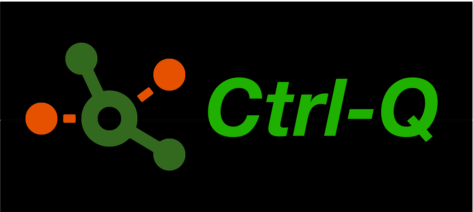
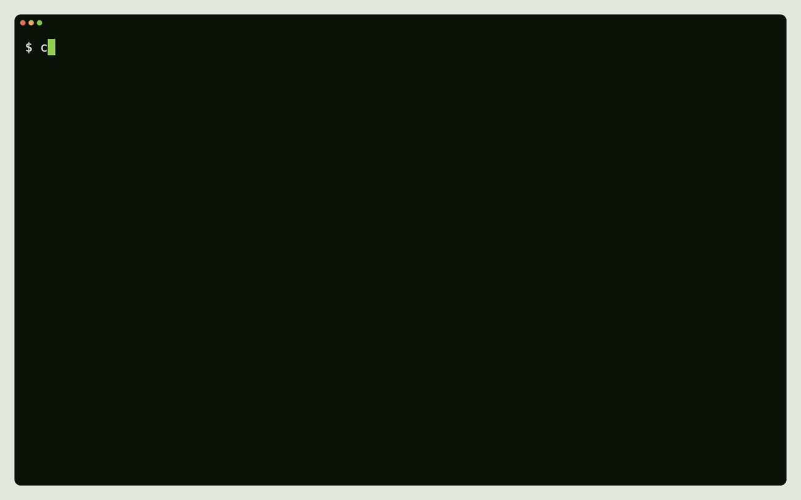

<h1 align="center">Ctrl-Q</h1>

<strong>Automate Qlik Sense Enterprise on Windows admin tasks from the command line</strong>

<a href="https://ctrl-q.ptarmiganlabs.com">Documentation</a> ·
<a href="https://github.com/ptarmiganlabs/ctrl-q/discussions">Questions</a> ·
<a href="https://github.com/ptarmiganlabs/ctrl-q/issues">Report a bug</a> ·
<a href="https://github.com/sponsors/ptarmiganlabs">❤️ Sponsor</a>

  

Ctrl-Q makes life easier for Qlik Sense admins and developers. It is a cross-platform command
line tool for interacting with client-managed Qlik Sense Enterprise on Windows, designed to be
easily extended when new features are needed.

## ❤️ Support the project

Ctrl-Q is free and open source, under the MIT licence. If you use it, please consider sponsoring its development: sponsorships pay for maintenance, bug fixes and new features, and keep the project going.

**[❤️ Sponsor Ptarmigan Labs on GitHub](https://github.com/sponsors/ptarmiganlabs)**

Other ways to help:

- ⭐ **Star the repository**: it helps others find the project.
- 💬 **Share your feedback** in [Discussions](https://github.com/ptarmiganlabs/ctrl-q/discussions): tell us how you use it.
- 🐛 **Report issues** in [Issues](https://github.com/ptarmiganlabs/ctrl-q/issues).
- 🍴 **Contribute**: pull requests are welcome.

_Maintained by [Göran Sander](https://github.com/mountaindude) and supported by [Ptarmigan Labs](https://ptarmiganlabs.com)._

---

Ctrl-Q has its own documentation site at [https://ctrl-q.ptarmiganlabs.com](https://ctrl-q.ptarmiganlabs.com).
