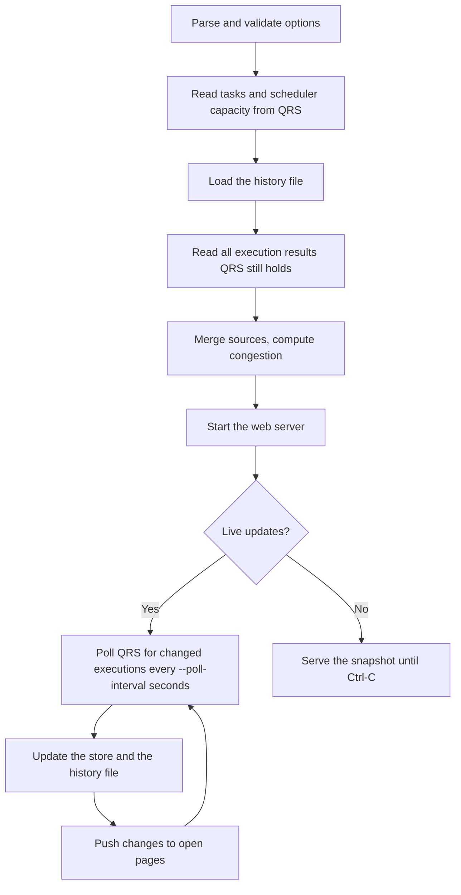

# qseow task-gantt

> Show reload task executions over time in a Gantt chart, to find reload congestion and the tasks involved

## Overview

The `task-gantt` command starts a small local web server and opens a Gantt-style view of task executions in Qlik Sense Enterprise on Windows:

- one horizontal lane per task, with time on the x axis,
- one bar per execution, coloured (and patterned) by its final status,
- a thin bar before each run showing how long it **waited** after being triggered, e.g. in the scheduler queue,
- a strip below the lanes showing how many reloads ran and waited at each moment, against the schedulers' capacity,
- a list of **congestion episodes**: periods when reloads waited in a scheduler queue, or all reload slots were busy, with the tasks involved, most waiting first.

The page updates live while it is open.

This command is useful for:

- Finding when reload congestion happens, and which tasks cause or suffer from it
- Seeing how long tasks wait in the scheduler queue before they start
- Spotting failing, slow or overlapping reloads
- Getting a feel for the reload load over the day and week

## Basic Syntax

```bash
ctrl-q qseow task-gantt --host <server> --auth-user-dir <dir> --auth-user-id <user> [options]
```

Then open the URL that Ctrl-Q prints, by default http://localhost:3001/. Press Ctrl-C to stop.

## Required Options

| Option                     | Description                           |
| -------------------------- | ------------------------------------- |
| `--host <host>`            | Qlik Sense server hostname or IP      |
| `--auth-user-dir <dir>`    | User directory for authentication     |
| `--auth-user-id <user>`    | User ID for authentication            |
| `--virtual-proxy <prefix>` | Virtual proxy prefix (default: empty) |
| `--secure <true\|false>`   | Use secure connection (default: true) |

## Authentication

### Certificate Authentication (Default)

```bash
--auth-type cert
--auth-cert-file ./cert/client.pem
--auth-cert-key-file ./cert/client_key.pem
--auth-root-cert-file ./cert/root.pem
--qrs-port 4242
```

The user needs read access in the Qlik Sense Repository Service (QRS) to:

- tasks, execution results and execution sessions,
- scheduler services (the capacity, `maxConcurrentEngines`),
- service clusters (the cluster id tells history files of different Sense sites apart; without it Ctrl-Q logs a warning),
- apps and streams (the names shown for each task's app; with `--app-tag`, the apps' tags).

The certificate user `INTERNAL\sa_api` has all of that.

### JWT Authentication

```bash
--auth-type jwt
--auth-jwt <jwt-token>
--qrs-port 443
--virtual-proxy <jwt-virtual-proxy>
```

With JWT, Ctrl-Q connects through the Sense proxy, so use the proxy port (usually 443) and a virtual proxy that accepts JWTs.

Two things to know when Ctrl-Q runs for a long time with a JWT:

- Ctrl-Q does **not** check the server's TLS certificate on JWT connections (`--secure` has no effect for JWT). The token is sent with every poll, so only use JWT on a network you trust, or use certificate authentication.
- Ctrl-Q sends the JWT with each request and does not reuse the proxy's session cookie. If the virtual proxy opens a session per request, many proxy sessions can build up; keep an eye on them, or use certificate authentication.

## Where the history comes from

Qlik Sense keeps only the **last few executions of each task** in the repository: by default the current one plus 3 older ones (`MinNumberOfExecutionResultsToKeepPerTask` in `Repository.exe.config`). The task execution history dialog in the QMC shows the same data. For a task that runs every hour that is about 4 hours of history, for a weekly task about 4 weeks.

Ctrl-Q therefore combines several sources:

| Source             | `--sources` name    | History                                                      | Freshness              | Notes                                                |
| ------------------ | ------------------- | ------------------------------------------------------------ | ---------------------- | ---------------------------------------------------- |
| QRS                | `qrs` (always used) | Last ~4 executions per task                                  | Live                   | Full detail: exact status, queue time, execution log |
| Local history file | `history-file`      | Everything Ctrl-Q has seen, up to `--history-retention-days` | Live while Ctrl-Q runs | Grows the longer, and the more often, Ctrl-Q runs    |

Executions that are still running are written to the history file too, and replaced by a later line when they finish. If Ctrl-Q stops before that and QRS no longer holds the execution later, the page shows its outcome as unknown.

The page never shows missing data as "nothing ran": time without data for a lane is **hatched**. That includes time before the oldest execution QRS still holds, time when Ctrl-Q was not running, and time after Ctrl-Q's last successful check of Sense.

> **Planned:** reading longer history (about 3 months) from the Operations Monitor app, and from the scheduler's log files.

## Reading the chart

| What you see          | Meaning                                                                                                                                                                     |
| --------------------- | --------------------------------------------------------------------------------------------------------------------------------------------------------------------------- |
| Thin light-blue bar   | The task was triggered and waited before it started. Long ones mean the scheduler queue was full.                                                                           |
| Solid bar             | The reload ran. Green = success, red-orange with diagonal stripes = failed, pink cross-hatched = aborted, orange with vertical stripes = error/reset, blue = still running. |
| Grey dashed bar       | State unknown: QRS still says "running" long after the task was triggered, with no running session, or only the history file has the execution, as running.                 |
| Yellow diamond        | The task was skipped.                                                                                                                                                       |
| Hatched area          | No data for this task in this period. Not the same as "nothing ran".                                                                                                        |
| Shaded band           | A congestion episode: reloads waited in a scheduler queue, or all reload slots were busy.                                                                                   |
| † before a task name  | The task no longer exists in Qlik Sense; its history comes from the history file.                                                                                           |
| Strip below the lanes | Running reloads (area) and queued reloads (dashed line) over time; the red dashed line is the schedulers' capacity (`maxConcurrentEngines`).                                |

Only **reload tasks** count towards the scheduler capacity. Congestion is always computed over all tasks, also when filters hide some of the lanes.

### Using the page

- **Zoom and pan:** drag the chart sideways, Ctrl + mouse wheel to zoom, or use the slider below the chart and the 6h/24h/3d/7d/All buttons. Scroll the mouse wheel over the chart to scroll through the lanes.
- **Click a bar** for the execution's details, including the state changes and messages QRS logged for it.
- **Click a task name** for the task's details and its latest 100 executions in the window.
- **Congestion** tab: click an episode to zoom to it and list the tasks involved.
- **Select range** (or press B): drag across the chart to list the tasks that ran in that period, sorted by time spent waiting.
- **Filter** lanes by text, tag, status, congestion and node, see [Filtering](#filtering). **Sort** lanes by first start, total queue wait, failures, total run time or name.
- **CSV** downloads the executions currently shown: those of the lanes shown, in the zoomed time range. The file opens in Excel with the right characters (UTF-8 with a byte order mark).
- **Follow live** keeps the newest data in view. Zooming or panning back in time turns it off.
- **Live indicator** in the header: green "live" while Ctrl-Q checks Sense successfully, orange "retrying" while Sense cannot be reached, red when live updates have stopped or the page lost its connection to Ctrl-Q. Time after Ctrl-Q's last successful check is hatched until it succeeds again.

### Filtering

On a site with hundreds or thousands of tasks, the filters in the toolbar find the lanes you need. They only choose what is drawn: the strip below the lanes and the congestion episodes always cover all tasks.

**Search box** (press / to jump to it): a task is shown when every word matches its name, app, stream or one of its tags. Case does not matter.

| You type                    | Shows the tasks that                                                                      |
| --------------------------- | ----------------------------------------------------------------------------------------- |
| `finance nightly`           | match both words, in any field                                                            |
| `"daily load"`              | contain the phrase, space included                                                        |
| `-test`                     | do not match `test`                                                                       |
| `tag:nightly`               | have a tag containing `nightly`. `app:`, `stream:` and `name:` look in those fields alone |
| `finance -test tag:nightly` | match all three                                                                           |

**Tags** lists every tag the tasks have, with the number of tasks that have it; the box at the top finds a tag. Click a tag once to show only the tasks with it (+), again to hide the tasks with it (struck out), and once more to stop using it. With several tags included, a task needs one of them. **Clear** stops using all tags. The button shows how many tags are in use.

**Status** has two groups of states:

- **Runs in view**: failed / aborted / error, waited in queue, running now, succeeded, skipped. Only the runs in a ticked state are drawn, and tasks without such a run are hidden. A run whose state is unknown (grey dashed) counts as failed.
- **Task**: last run failed (the latest run the page holds for the task failed, was aborted, ended in error or has an unknown state), disabled in Sense, deleted in Sense. These choose tasks only, and all their runs are drawn.

Ticked states in one group combine with OR, the two groups with AND.

**Only tasks in congestion** shows the tasks involved in a congestion episode that overlaps the time range on screen, and follows along as you zoom and pan. It uses the episodes listed on the Congestion tab, at most 50, most waiting first.

Different filters combine with AND. While any of them is active, the line above the chart says how many tasks are shown, e.g. "Showing 37 of 2,140 tasks". On the **Congestion** tab, **Only episodes with shown tasks** lists only the episodes that involve a task in the chart.

The filters, the node and the sort order are kept in the page address, after the `#`. A reload keeps them, and a bookmark or a link sent to a colleague opens the same view. That part of the address is never sent to Ctrl-Q, and the access token stays where it is (see [Security](#security)).

## Options

### Time window and sources

| Option                            | Default                  | Description                                                                                         |
| --------------------------------- | ------------------------ | --------------------------------------------------------------------------------------------------- |
| `--lookback <duration>`           | `7d`                     | How far back to show executions: a number followed by `m`, `h`, `d` or `w`, between `10m` and `90d` |
| `--sources <names...>`            | `qrs history-file`       | Where to get history from; QRS is always used                                                       |
| `--poll-interval <seconds>`       | `15`                     | How often to check Sense for new executions. `0` turns live updates off. Minimum 5.                 |
| `--history-dir <directory>`       | `~/.ctrl-q/task-history` | Where Ctrl-Q keeps the history it has seen                                                          |
| `--history-retention-days <days>` | `90`                     | History files older than this are deleted, when Ctrl-Q starts and once a day while it runs          |

### Which lanes to show

These options choose which tasks get a lane. They do **not** limit the congestion analysis, which always uses all reload tasks.

| Option                   | Default              | Description                                                               |
| ------------------------ | -------------------- | ------------------------------------------------------------------------- |
| `--task-type <types...>` | `reload ext-program` | Task types: `reload`, `ext-program`, `user-sync`, `distribute`, `preload` |
| `--task-id <ids...>`     |                      | Show these tasks (if they are of a `--task-type` type)                    |
| `--task-tag <tags...>`   |                      | Show tasks with any of these tags                                         |
| `--app-id <ids...>`      |                      | Show tasks of these apps                                                  |
| `--app-tag <tags...>`    |                      | Show tasks of apps with any of these tags                                 |

When several of `--task-id`, `--task-tag`, `--app-id` and `--app-tag` are given, a task matching any of them is shown. `--task-type` applies on top of them: to show a user sync task by its id, for example, also give `--task-type user-sync`.

### Web server

| Option                             | Default     | Description                                                        |
| ---------------------------------- | ----------- | ------------------------------------------------------------------ |
| `--vis-host <host>`                | `localhost` | Address the web server listens on                                  |
| `--vis-port <port>`                | `3001`      | Port of the web server                                             |
| `--vis-allow-remote [true\|false]` | off         | Required when `--vis-host` is not a loopback address, see Security |

## Security

- By default the page is only reachable from the computer Ctrl-Q runs on.
- To make it reachable from other computers, use e.g. `--vis-host 0.0.0.0 --vis-allow-remote`. Ctrl-Q then creates a random **access token** and prints URLs containing it: one for this computer (with `localhost`), and for other computers one with this computer's name and one per IP address. Without the token the page and its data cannot be loaded. Treat the URL like a password.
- On a loopback address (`localhost`, `127.0.0.1`, `::1`) the page has no token, also with `--vis-allow-remote`.
- The page only reads data; it cannot change anything in Qlik Sense.
- Credentials (`--auth-jwt`, certificate contents) are never written to the log.

## History file

The history is stored as one file per day (UTC) and Sense server, `<history-dir>/<host>/YYYY-MM-DD.ndjson`. Each line is a JSON object; the first line of each file identifies the Sense server and cluster. Besides the executions, the files record which periods are complete: from the oldest execution QRS held for each task, and while Ctrl-Q was watching live.

Files of another Sense cluster (e.g. after a reinstall under the same host name) are ignored. If one exists for today, Ctrl-Q writes this cluster's lines to `YYYY-MM-DD.<cluster>.ndjson` instead.

Only one Ctrl-Q instance writes to a history directory at a time. A second instance opens it read-only, and its source badge says so.

## Code Flow



## Usage Examples

### Last 7 days, live

```bash
ctrl-q qseow task-gantt \
  --host sense-server.example.com \
  --auth-user-dir INTERNAL \
  --auth-user-id sa_api
```

### Last 24 hours, only tasks tagged "Finance", no live updates

```bash
ctrl-q qseow task-gantt \
  --host sense-server.example.com \
  --auth-user-dir INTERNAL \
  --auth-user-id sa_api \
  --lookback 24h \
  --task-tag Finance \
  --poll-interval 0
```

### Let colleagues open the page

```bash
ctrl-q qseow task-gantt \
  --host sense-server.example.com \
  --auth-user-dir INTERNAL \
  --auth-user-id sa_api \
  --vis-host 0.0.0.0 \
  --vis-allow-remote
```

Ctrl-Q prints one URL per name or address of the computer it runs on. Share one that your colleagues' computers can reach:

```
Task Gantt chart, on this computer: http://localhost:3001/?token=…
Task Gantt chart, from other computers: http://admin-pc:3001/?token=…
Task Gantt chart, from other computers: http://10.11.12.13:3001/?token=…
```

## Environment Variables

| CLI Option                 | Environment Variable         |
| -------------------------- | ---------------------------- |
| `--log-level`              | CTRLQ_LOG_LEVEL              |
| `--host`                   | CTRLQ_HOST                   |
| `--qrs-port`               | CTRLQ_QRS_PORT               |
| `--virtual-proxy`          | CTRLQ_VIRTUAL_PROXY          |
| `--secure`                 | CTRLQ_SECURE                 |
| `--auth-user-dir`          | CTRLQ_USER_DIR               |
| `--auth-user-id`           | CTRLQ_USER_ID                |
| `--auth-type`              | CTRLQ_AUTH_TYPE              |
| `--auth-cert-file`         | CTRLQ_CERT_FILE              |
| `--auth-cert-key-file`     | CTRLQ_CERT_KEY_FILE          |
| `--auth-root-cert-file`    | CTRLQ_ROOT_CERT_FILE         |
| `--auth-jwt`               | CTRLQ_AUTH_JWT               |
| `--lookback`               | CTRLQ_LOOKBACK               |
| `--sources`                | CTRLQ_SOURCES                |
| `--poll-interval`          | CTRLQ_POLL_INTERVAL          |
| `--history-dir`            | CTRLQ_HISTORY_DIR            |
| `--history-retention-days` | CTRLQ_HISTORY_RETENTION_DAYS |
| `--task-type`              | CTRLQ_TASK_TYPE              |
| `--task-id`                | CTRLQ_TASK_ID                |
| `--task-tag`               | CTRLQ_TASK_TAG               |
| `--app-id`                 | CTRLQ_APP_ID                 |
| `--app-tag`                | CTRLQ_APP_TAG                |
| `--vis-host`               | CTRLQ_VIS_HOST               |
| `--vis-port`               | CTRLQ_TASK_GANTT_VIS_PORT    |
| `--vis-allow-remote`       | CTRLQ_VIS_ALLOW_REMOTE       |

For options that take several values, separate them with commas or spaces in the environment variable, e.g. `CTRLQ_TASK_TYPE="reload user-sync"`. Tag names may contain spaces, so `CTRLQ_TASK_TAG` and `CTRLQ_APP_TAG` are separated by commas only: `CTRLQ_TASK_TAG="Finance dept,HR"`. `CTRLQ_VIS_ALLOW_REMOTE` takes `true` or `false`.

## Error Handling

#### "QRS GET /qrs/task/full on <host>:<port> failed: ..."

Ctrl-Q could not read the tasks at startup, so it stops. The message ends with what to check:

- `connect ECONNREFUSED` or `socket hang up`: wrong port, or a firewall. Certificate authentication uses the QRS port, usually 4242; JWT goes through the proxy, usually `--qrs-port 443` with `--virtual-proxy`.
- `ENOTFOUND`: check the host name in `--host`.
- `HTTP 401` or `HTTP 403`: the certificate, user or JWT was rejected.
- `ECONNABORTED: timeout ...`: Sense did not answer in time.

#### "Port 3001 on localhost is already in use"

Another program, or another Ctrl-Q instance, uses the port. Pick another one with `--vis-port`.

#### "Binding the web server to ... requires an access token" / "--vis-host ... makes the page reachable from other computers"

Add `--vis-allow-remote`, or use `--vis-host localhost`.

#### The QRS badge says "error: Sense refused the request (HTTP 401/403)"

The certificate or JWT was rejected, or has expired. Live updates stop, the header says so, and the time after the last successful check is hatched. Fix the credentials and restart Ctrl-Q.

#### The QRS badge says "degraded: Live update failed ..."

Sense could not be reached. Ctrl-Q retries with growing intervals (up to 5 minutes), and the header says "retrying". After an outage longer than 15 minutes, or when the computer was asleep, the time in between shows as hatched (no data), because QRS may have discarded executions meanwhile.

#### The history file badge says "degraded: Too many executions to keep in memory"

The window holds more than 200,000 executions. Ctrl-Q keeps the newest ones; the time before them is hatched and left out of the congestion analysis. Use a shorter `--lookback`.

#### "Could not read the Sense cluster id"

The user cannot read service clusters in the QRS. Ctrl-Q works, but cannot tell this site's history files from those of another Sense site with the same host name.

#### The history file badge says "degraded: another Ctrl-Q instance is writing this history"

Another Ctrl-Q instance uses the same `--history-dir` for this Sense server. This instance shows the history but does not add to it.

#### Lanes show very little history

QRS only keeps the last few executions of each task. Let Ctrl-Q run (or run it regularly) so the history file builds up.

## See Also

- [qseow task-vis](https://ctrl-q.ptarmiganlabs.com) - the task chain network graph
- [Task execution status in the QMC](https://help.qlik.com/en-US/sense-admin/May2026/Subsystems/DeployAdministerQSE/Content/Sense_DeployAdminister/QSEoW/Administer_QSEoW/Managing_QSEoW/task-status-info.htm)
- [Apache ECharts](https://echarts.apache.org), which draws the chart
